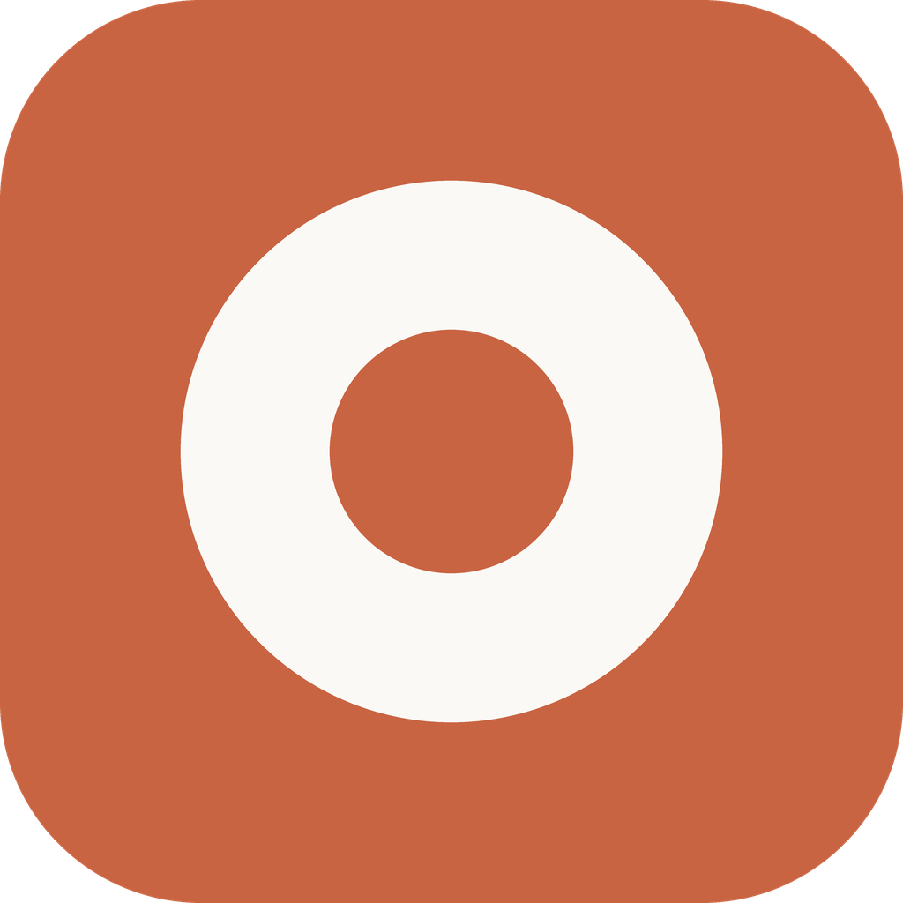
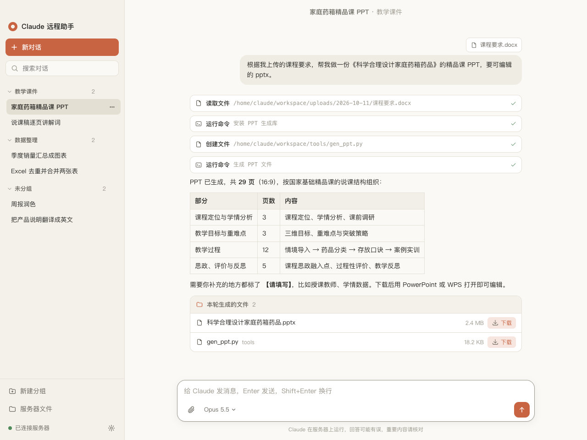
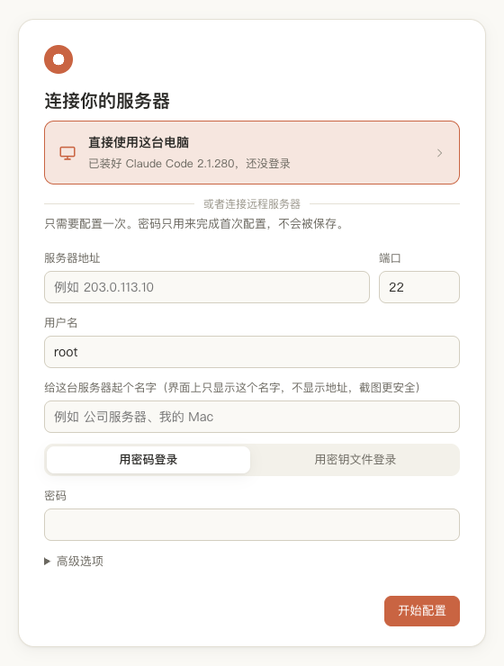
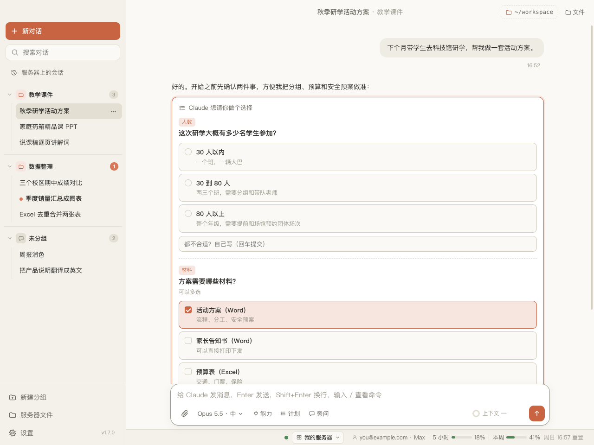
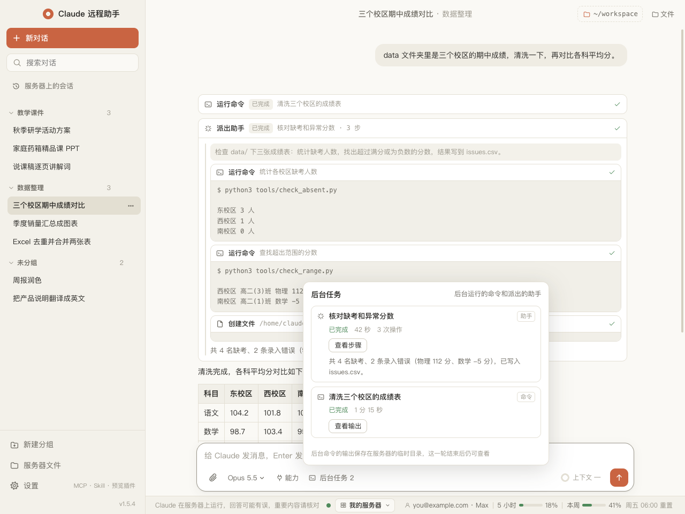

<div align="center">



# Claude Remote

**A desktop chat app for the Claude Code running on your own server**

Claude Code is powerful, but it lives in a terminal behind SSH — a wall for anyone who doesn't code.<br>
Claude Remote puts a familiar chat window on top of it: sessions and folders on the left, drag a file in to upload,<br>
and every file Claude makes shows up as a **Download** button. Setup needs only a server IP and its password.

[](LICENSE)
[](https://github.com/TomEageer/claude-remote/releases/latest)
[](https://github.com/TomEageer/claude-remote/releases/latest/download/ClaudeRemote-Setup.exe)
[](#quick-start)
[](https://github.com/TomEageer/claude-remote/releases)
[](#privacy)
[](#requirements)

[**⬇ Windows**](https://github.com/TomEageer/claude-remote/releases/latest/download/ClaudeRemote-Setup.exe) · [**⬇ macOS (Apple Silicon)**](https://github.com/TomEageer/claude-remote/releases/latest/download/ClaudeRemote-arm64.dmg) · [macOS (Intel)](https://github.com/TomEageer/claude-remote/releases/latest/download/ClaudeRemote-x64.dmg) · [Quick start](#quick-start) · [How it works](#how-it-works) · [FAQ](#faq) · [**中文文档**](README.zh-CN.md)

<picture>
  <source media="(prefers-color-scheme: dark)" srcset="docs/images/main-dark.png">
  
</picture>

</div>

---

## How it started

I built this for my girlfriend, a teacher. Claude Code is great at the things she needs every day — lesson slides, reading a pile of documents, tidying spreadsheets — but its front door is a terminal: SSH keys, installing a CLI, logging in, typing commands. That is a lot to ask of someone who doesn't code. So Claude Code runs on a server in the US that I set up once, and she uses an ordinary desktop chat window: type, drag files in, click to download what Claude made. Claude Remote is that window, cleaned up so anyone can use it.

## Why Claude Remote

Running Claude Code on a server is great: it keeps working when your laptop sleeps, it can install whatever it needs, and your files stay in one place. But the way in is `ssh` + a terminal UI, which non-technical people simply won't use. Claude Remote is the missing front door:

- 🧭 **Two-minute onboarding** — type the server IP and password once. The app generates its own SSH key, installs it, creates a dedicated non-root account, installs Claude Code and walks you through the Claude login. The password is never stored
- 💬 **Feels like the Claude app** — streaming replies, Markdown and tables, sessions organised into folders, search, rename, drag-to-regroup
- 📎 **Drag a file in, Claude reads it** — files are uploaded over SFTP to the server and their paths are handed to Claude automatically
- 📦 **Everything Claude makes is one click away** — file paths in replies become links (click to download, click the eye icon to preview), and each turn ends with a list of the documents, sheets, slides and images it produced; scripts and caches are folded away
- 👀 **Preview without downloading** — images, video, audio and web pages built in (with a download progress bar; files under 50 MB stay cached); PDF, Word, Excel, PowerPoint and code through installable preview plugins that run sandboxed with no network access; table columns can be dragged wider
- 📁 **A project folder per conversation** — Claude works in the folder you choose, with that folder's file panel right beside the chat; keep typing while Claude replies (messages queue and can be withdrawn)
- 📊 **Usage at a glance** — 5-hour and weekly plan usage always in the sidebar; click the context meter for a breakdown and one-click compaction
- 🔒 **Screenshot-safe** — servers appear only by the name you give them, addresses and user names stay masked; each server shows which Claude account it uses
- 🍎 **Linux, macOS and Windows hosts** — or skip SSH entirely and use the computer you are on (its existing Claude login just works); Windows hosts need the OpenSSH server and Git for Windows
- 🖥️ **Several servers** — switch servers from the top of the sidebar, each with its own conversations; `/login` re-authorizes Claude any time
- ⌨️ **Slash commands and editing** — type `/` for a command menu (switch conversation, change model, compact context, run a Skill…); edit and resend any of your messages
- 🙋 **Click to answer Claude's questions** — when Claude asks you to choose, the options appear as buttons (multi-select, or type your own answer)
- ⏳ **Subagents and background jobs** — every step a subagent takes is shown inside its card; commands Claude runs in the background get a panel with live output and a stop button
- 🗃️ **Picks up existing server sessions** — conversations you had with Claude Code in a terminal can be imported in one click, fully restored, and continued
- 🌿 **Branch and rewind** — fork a new conversation from any reply, or rewind to before one of your messages and resend; the original is kept
- 🧩 **MCP and Skills at a glance** — see the MCP servers, Skills and plugins on your server with connection status, add or remove them, and switch them per conversation
- 📏 **Context meter and timeline** — tokens in use vs. the model's window next to the send button; a time-machine style timeline to jump between messages
- 🔄 **Updates from GitHub** — background differential updates on Windows, a new-version notice on macOS
- 🗂️ **Server file manager** — back/forward, breadcrumb path, double-click to open, drop files to upload into the current folder, download whole folders, rename, create, delete
- 🛡️ **Sandboxed by default** — Claude runs as a separate ordinary user, so a bad instruction can't touch the other services on your server
- 🔀 **Pick the model per message** — Opus / Fable / Sonnet / Haiku from the input box; labels come from what the server actually ran
- 🆓 **Free and open source** — MIT, no telemetry, no accounts of ours, ~2,500 lines



<picture><source media="(prefers-color-scheme: dark)" srcset="docs/images/ask-dark.png"></picture> <picture><source media="(prefers-color-scheme: dark)" srcset="docs/images/tasks-dark.png"></picture>

|  | Claude Remote | Claude Code in an SSH terminal | VS Code Remote-SSH + Claude Code |
|---|---|---|---|
| Interface | **Chat window** | Terminal UI | Code editor + extension panel |
| First-time server setup | **Guided: IP + password** | Manual (keys, install, login) | Manual (keys, install, login) |
| Send a local file to Claude | **Drag into the input box** | `scp` by hand | Drag into the remote Explorer |
| Get Claude's output files | **Per-turn download list** | `scp` by hand | Right-click → Download |
| Session history | Local, with folders | `claude --resume` picker | Not tested |
| Per-action approval of commands | **No** — auto-approved inside a dedicated user | Yes | Yes |
| Needs your own Linux server | Yes | Yes | Yes |
| Signed installers | **No** (see FAQ) | — | Yes |

Where Claude Remote is weaker: it does not ask before each command (by design, for non-technical users — risk is contained by the dedicated account), its installers are not code-signed yet, and it is not a code editor.

## Quick start

1. **Download** — [Windows](https://github.com/TomEageer/claude-remote/releases/latest/download/ClaudeRemote-Setup.exe) · [macOS Apple Silicon](https://github.com/TomEageer/claude-remote/releases/latest/download/ClaudeRemote-arm64.dmg) · [macOS Intel](https://github.com/TomEageer/claude-remote/releases/latest/download/ClaudeRemote-x64.dmg)
2. **Install** — Windows: run the installer (SmartScreen → *More info* → *Run anyway*). macOS: drag to Applications, then **right-click → Open** the first time
3. **Connect your server** — enter the IP, port, username and password (or a key file). The wizard prepares everything; about 25 s on a fresh account, plus ~15 s if Claude Code has to be installed
4. **Log in to Claude** — click *Open browser to log in*, approve, paste the code back. Or paste an Anthropic API key instead
5. **Chat** — drag files in, pick a model, download results

## How it works

```
┌──────────── your computer ────────────┐            ┌──────────── your Linux server ────────────┐
│ Electron UI ── ssh2 (one connection) ─┼── SSH ────►│ claude -p --output-format stream-json      │
│   sessions, folders (local JSON)      │            │        --resume <session-id>               │
│   drag & drop ── SFTP upload ─────────┼── SFTP ───►│ ~/workspace/uploads/<date>/                │
│   per-turn files ◄── SFTP download ───┼◄── SFTP ───│ find ~/workspace -newermt @<turn start>    │
└───────────────────────────────────────┘            └────────────────────────────────────────────┘
```

- **Each message** runs the official Claude Code CLI in headless mode: `claude -p --input-format stream-json --output-format stream-json --include-partial-messages --permission-prompt-tool stdio` (the stdio permission channel is what lets Claude ask you multiple-choice questions; Windows hosts use plain text input), first turn with `--session-id`, later turns with `--resume`, so the conversation lives in Claude Code's own session store on the server
- **Streaming**: the JSON event stream is parsed into text deltas, tool calls and tool results, rendered as Markdown and collapsible tool cards
- **Stop** sends `SIGINT` to the exact remote process (its PID is printed before `exec`)
- **Generated files**: the turn's start time is captured on the server; when the turn ends the app runs `find -newermt` over the work folder (skipping `uploads/`, hidden folders and dependency caches) and shows the result as download buttons
- **Setup wizard**: connects once with your password or key, writes the app's own ed25519 public key to `authorized_keys` (for a dedicated user when you log in as root), installs Claude Code with the official installer, then runs `claude setup-token` in a PTY to obtain a long-lived token
- **Permissions**: Claude runs with `--permission-mode bypassPermissions`, which is why the wizard isolates it in an ordinary account by default

## Privacy

- **No telemetry**, no analytics — the app talks only to your server, with one exception: **preview plugins**. When you open the plugins page, or preview a file that needs a plugin, the app reads the plugin list and downloads plugin files from the GitHub repository [claude-remote-plugins](https://github.com/TomEageer/claude-remote-plugins) (falling back to jsDelivr mirrors; changeable in Settings to your own fork). Nothing is uploaded
- Plugins are **sha256-verified file by file**, run in their own origin, and their content-security policy blocks all network access and any access to the app itself; updates download only the files that changed
- **Your password is used once** during setup and never written to disk
- The Claude token is stored **only on your server** in `~/.claude-env` (mode `600`); the desktop app never sees it after setup
- Sessions and settings are stored locally in the app's data folder (`%APPDATA%\Claude 远程助手` on Windows, `~/Library/Application Support/Claude 远程助手` on macOS)

## FAQ

<details>
<summary><b>Is this a "relay" / proxy for Claude?</b></summary>

No. It is a front end for the official Claude Code CLI running on your own server, using your own login. No request is forwarded or resold. Note that personal Claude subscriptions are meant for one person — if several people use the app, give each of them their own Claude account (or use an API key).
</details>

<details>
<summary><b>Windows / macOS says the app is from an unknown developer</b></summary>

The installers are not code-signed yet. Windows: click *More info* → *Run anyway*. macOS: right-click the app → *Open* → *Open*, or *System Settings → Privacy & Security → Open Anyway*.
</details>

<details>
<summary><b>Why doesn't it ask before running commands?</b></summary>

The target users can't judge a shell command anyway, so approvals would just be noise. Instead, the wizard creates a dedicated ordinary account and Claude works inside it. If you log in as a non-root user, Claude has exactly that user's permissions.
</details>

<details>
<summary><b>Which servers work?</b></summary>

Any Linux server you can SSH into with `bash` and `curl`, and which can reach `claude.ai`. 2 GB RAM or swap is recommended — each running reply is a Claude Code process.
</details>

<details>
<summary><b>My server only accepts connections from the office network / a jump proxy</b></summary>

Set a **proxy** in the wizard's advanced options or in Settings: `socks5://host:port` or `http://host:port` (HTTP CONNECT), with optional `user:pass@`. For example, if your corporate VPN exposes a local SOCKS5 proxy on `127.0.0.1:1080`, enter `socks5://127.0.0.1:1080`. SSH, file transfer and the Claude login all go through it.
</details>

<details>
<summary><b>Can several computers use the same server?</b></summary>

Yes. Each computer runs the wizard (or gets its key added) and they share the same work folder. Session history stays on each computer.
</details>

## Requirements

- **Desktop**: Windows 10/11 (x64) or macOS 12+ (Apple Silicon or Intel)
- **Server**: Linux with SSH, `bash`, `curl`; outbound access to `claude.ai` / `api.anthropic.com`
- **Claude**: a Claude Pro/Max subscription or an Anthropic API key

## Support

Claude Remote is free. If it saved you time, see [DONATE.md](DONATE.md).

## Changelog

See [CHANGELOG.md](CHANGELOG.md).

## Contact

Issues and ideas: [GitHub Issues](https://github.com/TomEageer/claude-remote/issues) · [tomeageer.com](https://tomeageer.com)

## License

[MIT](LICENSE). Not affiliated with Anthropic. Claude and Claude Code are trademarks of Anthropic, PBC.

<sub>claude code gui · claude code desktop client · claude code over ssh · remote claude code · claude code for non-programmers · claude code windows app · claude code mac app · self-hosted claude workspace</sub>
