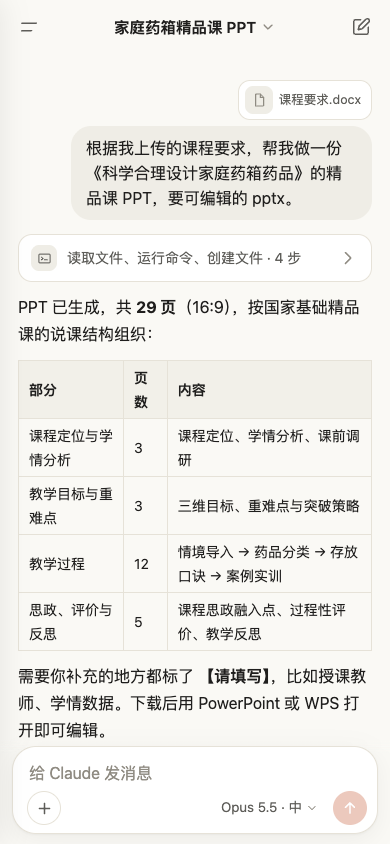
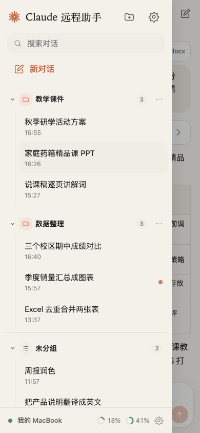

# 手机远程控制 · Remote control from your phone

[中文](#中文) · [English](#english)

---

## 中文

在手机上查看和操控电脑上 Claude 远程助手里的对话：看实时回复、发消息、开新对话、停止回复、回答 Claude 的提问、批准计划。效果类似 Claude Code 的 Remote Control，但**走你自己的服务器**，不经过任何第三方。

```
 手机浏览器 ──┐                         ┌── 电脑上的 Claude 远程助手
（网页 App）  └──►  你的中转服务器  ◄────┘   （开着就保持连接）
                    crrelay
                只转发加密后的内容
```

<p align="center"><picture><source media="(prefers-color-scheme: dark)" srcset="images/phone-chat-dark.png"></picture> <picture><source media="(prefers-color-scheme: dark)" srcset="images/phone-list-dark.png"></picture></p>

- **端到端加密**：每台手机扫码时从电脑拿到一把独立的密钥（tweetnacl secretbox / XSalsa20-Poly1305），中转服务器只看到密文，看不到对话内容
- **手机不用装 App**：中转程序里自带手机网页，扫码就能用；iPhone 和安卓都可以「添加到主屏幕」，像 App 一样全屏打开
- **一个程序、零依赖**：crrelay 是单个 Go 程序（约 8 MB），不需要数据库、Docker、Node
- **跟着软件一起更新**：每次发布新版本都会同时发布对应版本的中转程序；一键安装的服务器默认每天自动更新

### 需要准备

- 一台**电脑和手机都能访问到**的服务器（有公网 IP 的云服务器就行，配置最低的那种完全够用）
- 最好有一个**域名**解析到这台服务器：可以自动申请 HTTPS 证书，手机才能「添加到主屏幕」。没有域名也能用 IP + 端口，只是手机上只能在浏览器里打开
- 电脑上的 Claude 远程助手 1.6.0 或更新的版本

### 第一步：在服务器上安装中转程序

用 root 或 sudo 在服务器上运行下面任意一条（Linux，x86_64 或 ARM 都可以）：

**有域名（推荐）**——先把域名（比如 `relay.example.com`）解析到服务器，并放行 80、443 端口：

```sh
curl -fsSL https://github.com/TomEageer/claude-remote/releases/latest/download/install-relay.sh | sudo sh -s -- --domain relay.example.com
```

**没有域名**——直接用 IP 和端口（下面用 8787，记得在云服务器的安全组 / 防火墙里放行这个端口）：

```sh
curl -fsSL https://github.com/TomEageer/claude-remote/releases/latest/download/install-relay.sh | sudo sh -s -- --port 8787
```

**已经有 Nginx / Caddy**——让中转程序只监听本机，由它们负责 HTTPS（配置见下文）：

```sh
curl -fsSL https://github.com/TomEageer/claude-remote/releases/latest/download/install-relay.sh | sudo sh -s -- --port 8787 --local
```

装完会打印两样东西，下一步要用：

```
  在电脑上打开 Claude 远程助手 → 设置 →「远程控制」，填：
    中转地址：https://relay.example.com
    访问令牌：3f9c…（一长串字母数字）
```

忘了令牌可以在服务器上运行 `sudo crrelay token list` 查看，要给别人用、限制流量见下文「给别人用」。

安装脚本做了这些事：下载对应版本的 `crrelay` 到 `/usr/local/bin`，注册成 systemd 服务 `crrelay`（开机自启、挂了自动重启），访问令牌和证书放在 `/var/lib/crrelay`，并加一个每天检查一次更新的定时任务。

| 想做的事 | 命令 |
|---|---|
| 更新到最新版 | 再运行一次安装命令（不带参数也行，会沿用上次的设置） |
| 关掉自动更新 | 安装命令后面加 `--no-auto-update` |
| 看日志 | `journalctl -u crrelay -f` |
| 重启 | `sudo systemctl restart crrelay` |
| 卸载 | `curl -fsSL …/install-relay.sh \| sudo sh -s -- --uninstall` |

> 服务器访问不了 GitHub？可以先在别的地方下载 `crrelay-linux-amd64.gz` 和 `install-relay.sh` 放到自己的镜像，运行前设置 `CRRELAY_DOWNLOAD=https://你的镜像地址`。

### 第二步：电脑连接中转服务器

打开 Claude 远程助手 → **设置** → **远程控制**：

1. 勾选「开启远程控制」
2. 填上一步打印的**中转地址**和**访问令牌**
3. 点「保存并连接」，看到「已连接中转服务器」就好了

电脑上的软件开着时会一直保持连接，断了会自动重连。

### 第三步：添加手机

1. 在「远程控制」页点「添加手机」，起个名字，电脑上会弹出二维码和一串配对码
2. 手机配对，三种方式任选：
   - 用手机**相机**扫二维码，会在浏览器里打开并自动配对
   - 手机浏览器打开中转地址，点「扫描二维码」，在页面里直接扫（不依赖系统相机能不能识别网址）
   - 扫不了码：在电脑上点「复制配对码」发到手机，手机页面点「输入配对码」粘贴进去
3. （推荐）添加到主屏幕：iPhone 在 Safari 里点分享按钮 →「添加到主屏幕」；安卓在 Chrome 菜单里点「添加到主屏幕」/「安装应用」

二维码里带着这台手机的密钥，**不要截图发给别人**。换了浏览器或清了浏览器数据，在电脑上点那台手机旁边的「二维码」重新扫一次就行。手机丢了，在电脑上点「撤销」，它就再也连不上了。

### 手机上能做什么

界面照着 Claude 手机版设计：左上角打开对话列表，右上角开新对话，底部是输入卡片。

- **对话列表**：和电脑上一样的置顶、分组，可以搜索；长按一个对话可以重命名、置顶、移到分组、删除；顶部的文件夹按钮新建分组，分组右边的「⋯」改名或删除，点分组标题收起 / 展开；底部显示电脑在线状态和额度
- **实时回复**：回复中的对话实时更新，连续的工具步骤收成一行，点开看每一步和结果；代码块可以一键复制
- **发消息**：对话空闲时直接发出；Claude 正在回复时会像在电脑上一样合并进当前这一轮；输入框为空时发送按钮变成**停止**；输入 `/` 列出命令和 Skill
- **发图片和文件**：输入框左边的 **+**，可以拍照、选照片或文件（大照片会先压缩），经电脑传到服务器交给 Claude
- **模型和思考强度**：点输入框右边的模型名切换（思考强度是滑动条），和电脑上的选择同步
- **手势**：从左往右滑打开对话列表、往左滑收起，弹层往下拖关闭；左上角对话列表顶部可以切换服务器，齿轮进入设置（外观、文字大小、配对管理）
- **计划模式**：**+** 里打开，Claude 先写方案，批准后才动手
- **看生成的文件**：回复下面的「本轮生成的文件」和回复里的文件路径都能点开预览（文档、图片、表格、PDF、音视频、网页）；Office 文件用右上角的分享按钮交给系统打开
- **新对话**：可以选在哪台服务器、哪个文件夹里运行
- **等你做选择时**：列表里那个对话会闪，菜单按钮上有提醒点，顶部有一条可以点的提示；点选项回答 Claude 的提问，批准或打回计划

### 给别人用：每人一个令牌、每月流量额度

中转可以有多个访问令牌，每个令牌单独计流量、单独设每月额度。额度用完后，用这个令牌的电脑会断开，并显示「本月中转流量已用完，下个月 1 号自动恢复」；电脑端每 10 分钟自动重试，下个月一到就连上。在服务器上用 root 运行：

| 想做的事 | 命令 |
|---|---|
| 看所有令牌、额度和本月用量 | `crrelay token list` |
| 给别人新建一个令牌（每月 30 GB） | `crrelay token add 张三 30G`（会打印出令牌，发给他） |
| 新建一个不限额度的令牌 | `crrelay token add 我自己` |
| 改额度（0 表示不限） | `crrelay token quota 张三 50G` |
| 改名 | `crrelay token rename 默认 同事共用` |
| 再看一次某个令牌 | `crrelay token show 张三` |
| 停用某个令牌 | `crrelay token remove 张三` |

改完立刻生效，不用重启。流量按「电脑和它的手机之间转发的内容」算，来回都算；手机网页本身的加载不算。原来只有一个令牌的服务器，升级后那个令牌叫「默认」、不限额度，用法不变。

### 用 Nginx / Caddy 做 HTTPS

中转程序用 `--port 8787 --local` 安装后只监听 `127.0.0.1:8787`。需要把 `/ws` 的 WebSocket 一起转发过去：

**Caddy**

```
relay.example.com {
    reverse_proxy 127.0.0.1:8787
}
```

**Nginx**

```nginx
server {
    listen 443 ssl http2;
    server_name relay.example.com;
    ssl_certificate     /path/to/fullchain.pem;
    ssl_certificate_key /path/to/privkey.pem;

    location / {
        proxy_pass http://127.0.0.1:8787;
        proxy_http_version 1.1;
        proxy_set_header Upgrade $http_upgrade;
        proxy_set_header Connection "upgrade";
        proxy_set_header Host $host;
        proxy_read_timeout 3600s;
    }
}
```

### 不用 Linux / 不想用安装脚本

到 [Release 页面](https://github.com/TomEageer/claude-remote/releases/latest) 下载对应系统的中转程序，解压后直接运行：

| 文件 | 系统 |
|---|---|
| `crrelay-linux-amd64.gz` / `crrelay-linux-arm64.gz` | Linux |
| `crrelay-darwin-arm64.gz` / `crrelay-darwin-amd64.gz` | macOS |
| `crrelay-windows-amd64.zip` | Windows |

```sh
gunzip crrelay-linux-amd64.gz && chmod +x crrelay-linux-amd64
./crrelay-linux-amd64 --domain relay.example.com     # 自动 HTTPS（要 80、443 端口）
./crrelay-linux-amd64 --listen :8787                 # 只开 HTTP
./crrelay-linux-amd64 --cert fullchain.pem --key privkey.pem --listen :443   # 用自己的证书
```

其他参数：`--data 目录`（令牌和证书存放位置，默认 root 用 `/var/lib/crrelay`、普通用户用 `~/.crrelay`），`--token 令牌`（自己指定令牌，也可以用环境变量 `CRRELAY_TOKEN`），`--version`。

### 常见问题

**电脑上显示「访问令牌不对」**：令牌要和服务器上 `crrelay token list` 列出的某一个一致（`crrelay token show 名字` 看完整令牌），注意不要多复制空格。

**电脑上显示「连不上中转服务器」**：先在电脑浏览器里打开 `中转地址/healthz`，应该显示 `ok 版本号`。打不开就是端口没放行、域名没解析好，或者证书还没申请下来（用 `--domain` 时第一次访问要等几秒）。

**手机上显示「电脑不在线」**：电脑上的软件要开着，并且「远程控制」页显示已连接。电脑睡眠时也会断开。

**手机上显示「这台手机已被电脑撤销」**：在电脑上重新添加这台手机再扫码。

**安全吗？** 中转服务器只负责转发，看不到内容：消息在电脑和手机两端用每台手机独立的密钥加密，密钥只在扫码时从电脑屏幕传到手机，从不经过网络。中转服务器的访问令牌只用来防止别人拿你的服务器给他们的电脑当中转。用 IP + HTTP 方式时，内容依然是加密的，但建议正式使用时配上域名和 HTTPS。

---

## English

Control the conversations in Claude Remote on your computer from your phone: watch replies stream in, send messages, start new chats, stop a reply, answer Claude's questions and approve plans. Similar to Claude Code's Remote Control, but it goes through **your own server** and no third party.

- **End-to-end encrypted** — each phone gets its own key when it scans the pairing QR code (tweetnacl secretbox / XSalsa20-Poly1305); the relay only ever sees ciphertext
- **No app to install** — the relay serves the phone web app; add it to the home screen on iPhone or Android
- **One static binary** — `crrelay` is a single Go program (~8 MB), no database, Docker or Node
- **Released with the app** — every release ships a matching relay; servers installed with the script update themselves daily

### 1. Install the relay on a server

On any Linux server both your computer and phone can reach (x86_64 or ARM):

```sh
# with a domain pointed at the server (automatic HTTPS; ports 80 and 443 open)
curl -fsSL https://github.com/TomEageer/claude-remote/releases/latest/download/install-relay.sh | sudo sh -s -- --domain relay.example.com
# without a domain (plain HTTP on a port; open it in your firewall)
curl -fsSL https://github.com/TomEageer/claude-remote/releases/latest/download/install-relay.sh | sudo sh -s -- --port 8787
# behind your own Nginx / Caddy (listens on 127.0.0.1 only)
curl -fsSL https://github.com/TomEageer/claude-remote/releases/latest/download/install-relay.sh | sudo sh -s -- --port 8787 --local
```

It prints the **relay URL** and an **access token** (also in `/var/lib/crrelay/token`). Run the command again to update; add `--no-auto-update` to disable the daily update check, or `--uninstall` to remove it. Logs: `journalctl -u crrelay -f`. Binaries for Linux, macOS and Windows are also on the [release page](https://github.com/TomEageer/claude-remote/releases/latest) (`crrelay --domain …`, `--listen :8787`, or `--cert/--key`).

### 2. Connect the desktop app

**Settings → Remote control**: tick *Enable*, enter the relay URL and token, click *Save and connect*.

### 3. Add your phone

Click *Add phone*, scan the QR code with the phone camera, then *Add to Home Screen*. The QR code contains that phone's key — don't share it. Lost a phone? Click *Revoke*.

For Nginx / Caddy reverse-proxy examples see the Chinese section above (the configs are the same); remember to pass WebSocket upgrade headers for `/ws`.
